<a href="https://hu.berlin/diesingj">
  <picture>
    <source media="(prefers-color-scheme: dark)" srcset="./assets/header-dark.svg">
    <source media="(prefers-color-scheme: light)" srcset="./assets/header-light.svg">
    
  </picture>
</a>

 

  
  
  
  

<picture>
  <source media="(prefers-color-scheme: dark)" srcset="./assets/pillars-dark.svg">
  <source media="(prefers-color-scheme: light)" srcset="./assets/pillars-light.svg">
  
</picture>

 

### Selected Projects & Research

<table>
  <tr>
    <td width="50%" valign="top">
      <strong>Academic Typst Templates</strong> <code>IN PROGRESS</code> 
      Typst · Scientific Typesetting · Open Source  
      A curated collection of clean, publication-ready <strong>Typst</strong> templates for Bachelor/Master theses, seminar papers, and empirical research reports — inspired by Swiss/German academic typography.
    </td>
    <td width="50%" valign="top">
      <strong>Algorithmic Fairness in Credit Scoring</strong> <code>2026</code> 
      Python · Machine Learning · PRISMA  
      Systematic literature review (PRISMA) and empirical benchmark of in-processing fairness methods in ML, examining trade-offs between predictive accuracy, group fairness, and economic utility in credit risk modeling.
    </td>
  </tr>
  <tr>
    <td width="50%" valign="top">
      <strong>Empirical Research in Finance</strong> <code>2026</code> 
      R · Econometrics · Event Study  
      Empirical analysis of corporate and capital-market data in R — investigating the relationship between accounting ratios and stock returns via regression models alongside an event study on Brexit market reactions.
    </td>
    <td width="50%" valign="top">
      <strong>AI Workflows for Corporate Reporting &amp; Audit</strong> 
      Python · LLM Agents · Document Analysis  
      Prototyping LLM-assisted analysis pipelines for financial statements, IFRS disclosures, and digital audit innovation — bridging domain requirements from accounting with applied AI systems.
    </td>
  </tr>
</table>

 

### Experience & Education

<table>
  <tr>
    <td width="24%" valign="top"><strong>Practice</strong></td>
    <td valign="top">
      <strong>KPMG</strong> — <em>Audit Technology | Digital Audit Innovation</em> (Working Student · Oct 2026 – Sep 2027 · Berlin) 
      Designing, building, and evaluating AI agents to support and automate audit workflows.
        
      <strong>Wirtschaftsprüferkammer</strong> — <em>Financial Statement Review / Market Structures</em> (Working Student · Oct 2024 – Sep 2026 · Berlin) 
      Self-initiated AI prototype for automated analysis of accounting documents; review of published financial statements and German audit market data analysis.
    </td>
  </tr>
  <tr>
    <td width="24%" valign="top"><strong>Education</strong></td>
    <td valign="top">
      <strong>Humboldt-Universität zu Berlin</strong> — <em>B.Sc. Business Administration</em> (Oct 2023 – present) 
      Focus: Accounting (IFRS, consolidated reporting), Empirical Finance, Econometrics, and Business Information Systems.
    </td>
  </tr>
</table>

 

  
<strong>Technical Stack, Methods &amp; Tools</strong> (click to expand)

   
  <table>
    <tr>
      <td width="28%" valign="top"><strong>Data &amp; Programming</strong></td>
      <td><code>Python</code> (AI prototypes, data pipelines) · <code>R</code> (empirical finance, econometrics) · <code>Excel VBA</code></td>
    </tr>
    <tr>
      <td valign="top"><strong>AI &amp; Engineering</strong></td>
      <td>LLM workflows &amp; AI agents (<code>OpenAI API</code>, <code>Gemini API</code>, <code>Hugging Face</code>, local models via <code>Ollama</code>) · <code>Git</code> &amp; <code>GitHub</code></td>
    </tr>
    <tr>
      <td valign="top"><strong>Academic &amp; Typesetting</strong></td>
      <td><code>Typst</code> · <code>LaTeX</code> · Regression Analysis · Event Studies · Systematic Literature Reviews (PRISMA)</td>
    </tr>
    <tr>
      <td valign="top"><strong>Languages</strong></td>
      <td>German (native) · English (fluent)</td>
    </tr>
  </table>

 

  Julius Diesing · Humboldt-Universität zu Berlin · <a href="https://hu.berlin/diesingj">hu.berlin/diesingj</a>

