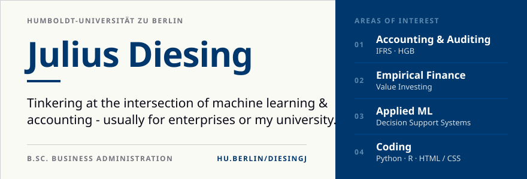
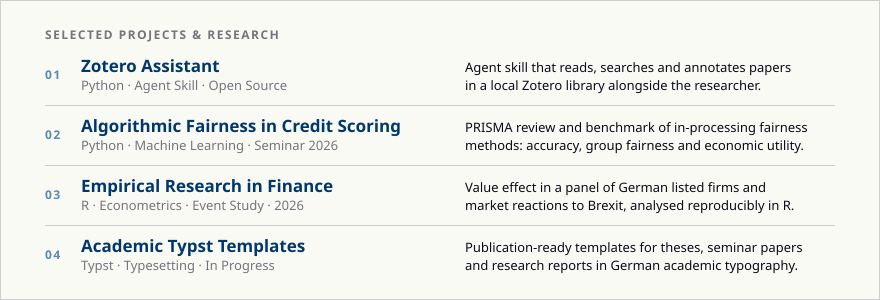
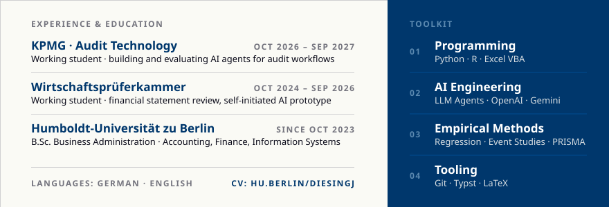

<a href="https://hu.berlin/diesingj">
  <picture>
    <source media="(prefers-color-scheme: dark)" srcset="./assets/header-hu-dark.svg">
    <source media="(prefers-color-scheme: light)" srcset="./assets/header-hu-light.svg">
    
  </picture>
</a>

   
  
  
  
  

  <a href="https://github.com/JuliusD9500?tab=repositories">
    <picture>
      <source media="(prefers-color-scheme: dark)" srcset="./assets/projects-hu-dark.svg">
      <source media="(prefers-color-scheme: light)" srcset="./assets/projects-hu-light.svg">
      
    </picture>
  </a>

  <a href="https://hu.berlin/diesingj">
    <picture>
      <source media="(prefers-color-scheme: dark)" srcset="./assets/experience-hu-dark.svg">
      <source media="(prefers-color-scheme: light)" srcset="./assets/experience-hu-light.svg">
      
    </picture>
  </a>

Julius Diesing · Humboldt-Universität zu Berlin · julius.diesing@student.hu-berlin.de

